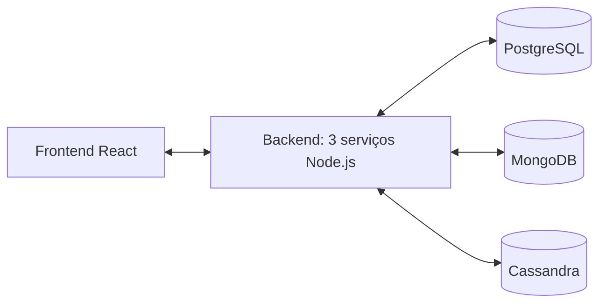

# PJT - Tunning de Dados / Garagem Poliglota

Projeto da disciplina **CCD410 — Performance e Tuning de Dados**, sobre **Polyglot Persistence**.



## 1. Tema

Um sistema de gestão para uma **rede de estacionamentos e garagens**. Ele cobre:
- o cadastro de clientes e seus veículos;
- o cadastro das unidades da rede, com suas vagas e tarifas;
- o controle operacional de entrada e saída de veículos, com cálculo automático de quanto cada permanência custa.

O sistema distingue dois tipos de cliente:
- **Mensalista**: vinculado a uma garagem específica por meio de um plano. Ao sair, não gera cobrança adicional.
- **Avulso**: paga pelo tempo de permanência, calculado a partir da tarifa da garagem usada.

Não há reserva de vaga. O mensalista já é credenciado (tem acesso garantido na sua garagem) e o avulso usa uma vaga livre quando chega.

## 2. Bancos utilizados e arquitetura do backend

Cada banco foi escolhido pelo formato e pelo padrão de acesso do dado que ele guarda.

### RDB — PostgreSQL
Guarda **Cliente**, **Veículo** e **Plano**. Esses dados têm relação forte entre si e exigem integridade referencial e transações. Por exemplo, encerrar uma mensalidade não pode deixar o plano num estado inconsistente. É o caso de uso clássico de um banco relacional.

### DB1 — MongoDB (document store)
Guarda **Garagem**. Cada unidade da rede tem uma estrutura própria (tipos de vaga, faixas de tarifa, comodidades) que varia de unidade para unidade. Um schema flexível se encaixa melhor do que colunas fixas.

### DB2 — Cassandra (wide-column)
Guarda **Sessão** (entrada e saída de veículos), particionada por garagem e dia e ordenada por horário. Há alto volume de escrita, e a consulta típica é sempre "sessões desta garagem num intervalo de tempo". É um padrão de série temporal, o caso de uso canônico de wide-column.

### Backend

Dividido em **3 serviços independentes** (Node.js + Express), cada um dono de exatamente um banco:

| Serviço | Banco | Responsabilidade |
|---|---|---|
| [`clientes-service`](backend/clientes-service) | PostgreSQL | CRUD de cliente, veículo e plano de mensalista |
| [`garagens-service`](backend/garagens-service) | MongoDB | CRUD das unidades da rede: endereço, vagas por tipo, tarifas |
| [`sessoes-service`](backend/sessoes-service) | Cassandra | Check-in e check-out (consulta os outros dois serviços para decidir entre mensalista e avulso e calcular o valor), consultas por período e exclusão de sessões |

Os serviços só conversam por HTTP: o serviço de sessões nunca acessa o PostgreSQL ou o MongoDB diretamente. O [`frontend`](frontend) (React) consome as APIs dos três serviços e também nunca acessa um banco.

### Operações de CRUD

Todas as entidades têm Create, Read, Update e Delete no backend **e** no frontend:

| Entidade (banco) | Create | Read | Update | Delete | Onde no frontend |
|---|---|---|---|---|---|
| Cliente (PostgreSQL) | `POST /clientes` | `GET /clientes`, `GET /clientes/:id` | `PUT /clientes/:id` | `DELETE /clientes/:id` | Clientes → Cadastrar / Editar dados / Excluir |
| Veículo (PostgreSQL) | `POST /veiculos` | `GET /veiculos` | `PUT /veiculos/:id` | `DELETE /veiculos/:id` | Clientes → Adicionar / Editar / Remover |
| Plano (PostgreSQL) | `POST /planos` | `GET /planos` | `PUT /planos/:id`, `PATCH /planos/:id/encerrar` | `DELETE /planos/:id` | Clientes → Criar plano / Alterar valor / Encerrar / Excluir |
| Garagem (MongoDB) | `POST /garagens` | `GET /garagens`, `/garagens/proximas` | `PUT` e `PATCH /garagens/:id` | `DELETE /garagens/:id` | Garagens → Cadastrar / Editar / Desativar / Excluir |
| Sessão (Cassandra) | `POST /sessoes/checkin` | `GET /garagens/:id/sessoes`, `/ocupacao`, `/veiculos/:placa/sessoes` | `POST /sessoes/checkout` | `DELETE /sessoes/:sessao_id` | Operação → Entrada / Saída / Cancelar · Relatórios → Excluir |

A "compra" do exemplo do enunciado corresponde aqui ao **check-in e check-out**: o Serviço de Sessões consulta os outros dois serviços (o cliente é mensalista nesta garagem? qual é a tarifa?) e calcula o valor.

## 3. Como executar

### Opção 1 — tudo com Docker (recomendado)

O único pré-requisito é o [Docker](https://www.docker.com/) com Docker Compose.

```bash
docker compose up -d --build
```

Depois, abra **http://localhost:5173**.

Esse comando sobe os **7 containers**: os 3 bancos, os 3 serviços de backend e o frontend.

- **Primeira execução:** baixa as imagens e compila os serviços, o que leva alguns minutos. O Cassandra leva mais 1 a 2 minutos até aceitar conexões; os outros serviços esperam por ele sozinhos (healthchecks).
- **Ambiente novo:** cada serviço cria o próprio schema (tabelas, coleção com validador, keyspace) e, se o banco estiver vazio, insere dados de exemplo: 4 clientes, 4 garagens e 10 mil sessões dos últimos 30 dias. Não é preciso rodar mais nada além do comando acima.
- **Acompanhar a subida:** `docker compose ps` mostra o estado de cada container, e `docker compose logs -f sessoes` mostra os logs de um serviço.
- **Parar:** `docker compose down`. Para apagar também os dados, use `docker compose down -v`.

| Serviço | Endereço | Banco |
|---|---|---|
| Frontend | http://localhost:5173 | — |
| [`clientes-service`](backend/clientes-service) | http://localhost:3001 | PostgreSQL (`localhost:5433`) |
| [`garagens-service`](backend/garagens-service) | http://localhost:3002 | MongoDB (`localhost:27017`) |
| [`sessoes-service`](backend/sessoes-service) | http://localhost:3003 | Cassandra (`localhost:9042`) |

> O PostgreSQL usa a porta **5433** no host, para não conflitar com um PostgreSQL instalado localmente.

### Opção 2 — serviços rodando com Node (desenvolvimento)

Pré-requisitos: Docker e [Node.js](https://nodejs.org/) 20+.

```bash
docker compose up -d postgres mongo cassandra    # só os bancos
```

Depois, rode cada serviço num terminal separado. Sem `.env`, os valores padrão já apontam para os bancos do compose; o `.env.example` existe para quem quiser mudar algo.

```bash
cd backend/garagens-service && npm install && npm run seed && npm run dev   # :3002
cd backend/clientes-service && npm install && npm run seed && npm run dev   # :3001
cd backend/sessoes-service  && npm install && npm run dev                   # :3003 (precisa dos outros dois)
cd backend/sessoes-service  && npm run seed -- 20000 30                     # opcional: histórico de sessões
cd frontend                 && npm install && npm run dev                   # :5173
```

Testes do cálculo de cobrança: `cd backend/sessoes-service && npm test`.

## Estrutura do repositório

```
.
├── backend/
│   ├── clientes-service/   # RDB — PostgreSQL  (Dockerfile, db/schema.sql, src/)
│   ├── garagens-service/   # DB1 — MongoDB     (Dockerfile, src/)
│   └── sessoes-service/    # DB2 — Cassandra   (Dockerfile, db/schema.cql, src/, test/)
├── frontend/               # React + Vite      (Dockerfile → nginx)
└── docker-compose.yml      # bancos + serviços + frontend
```

Cada pasta tem o próprio README com o modelo de dados, os índices e as decisões de desempenho de cada banco.
